# orch core

**Let coding agents do the work. Keep every decision yours.**

orch core is a way of working with coding agents: every piece of work is a ticket, every ticket follows a fixed path, and a person signs each step that matters. Agents file tickets, write the requirements and the plan, do the work and attach the evidence. You approve the requirements and the plan and give the final verdict, and you sign in a physical way: with your fingerprint or your phone. An agent can type any command, but it can't put a finger on the sensor.

It works with Claude Code, Codex and any other agent that can run a shell command. Tickets are plain files in your workspace. Mission Control (desktop) and orch mobile (iPhone) show you what's waiting for you.

<p align="center">
  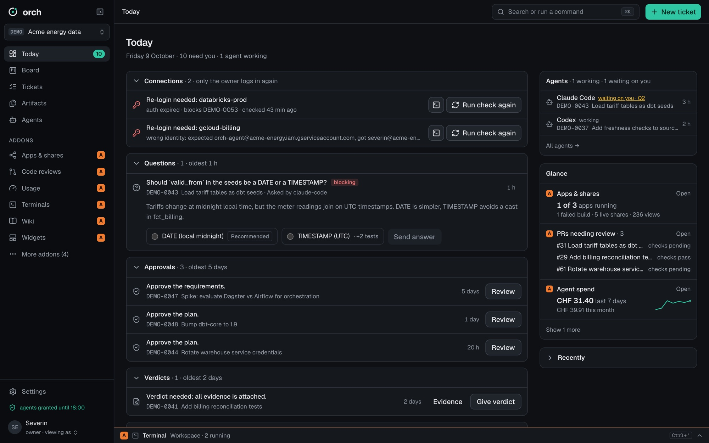
</p>

**Website: [severin.io/orch-core](https://severin.io/orch-core/)**

## Why

Agents are fast, confident and happy to approve their own plan. After a week on another project, I came back and couldn't tell where things stood, because the agents had done the work, not me. orch came out of four problems I kept running into:

<picture>
  <source media="(prefers-color-scheme: dark)" srcset="docs/images/readme/problems-dark.png">
  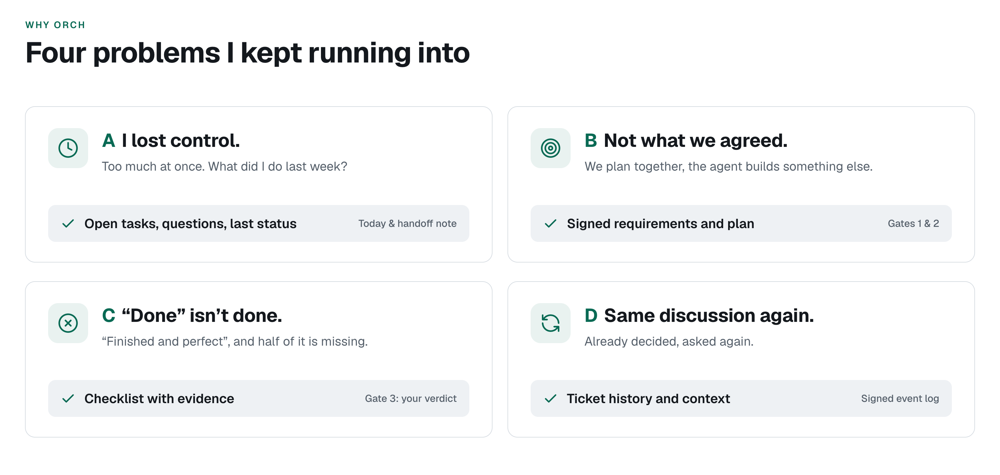
</picture>

## How it works

Everything flows into the core. A request comes in, in the requester's own words. The agent gets the keys and the knowledge it needs, follows your skills and rules, and writes every step into the ticket. People answer questions and sign the gates. The results go back to your tracker, docs, code host and data platform, and every finished ticket adds to what the next one can draw on.

<picture>
  <source media="(prefers-color-scheme: dark)" srcset="docs/images/readme/flow-dark.png">
  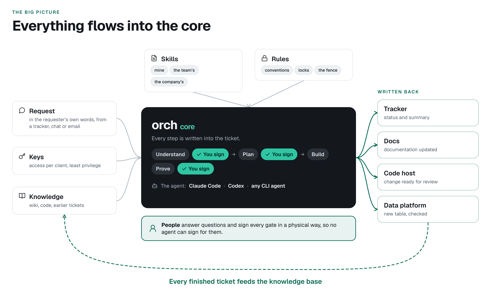
</picture>

Each ticket follows the same path, with a gate before every next step:

<picture>
  <source media="(prefers-color-scheme: dark)" srcset="docs/images/readme/gates-dark.png">
  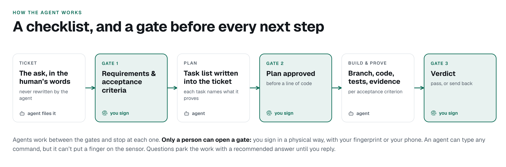
</picture>

- **Gates only a person can open.** Approvals, answers and verdicts are bound to the exact text you saw and need a physical act to sign: your fingerprint or your phone (Face ID). Hardware keys and TPM chips are next. Agents get no signing commands, and orch refuses a gate without a person's signature.
- **Agents that ask instead of guessing.** `orch ask` parks a question with options and a recommended answer, and `orch wait` blocks until you reply, at your desk or on your phone.
- **Evidence, not claims.** Acceptance criteria, a task list ticked off with proof, and artifacts (screenshots, test reports, PRs) per criterion, before a ticket reaches your verdict.
- **Memory that survives a holiday.** Every change is an appended, signed event. The current-state note on each ticket tells you where it stands and what's next.

### A checklist, and evidence for every item

<picture>
  <source media="(prefers-color-scheme: dark)" srcset="docs/images/readme/evidence-dark.png">
  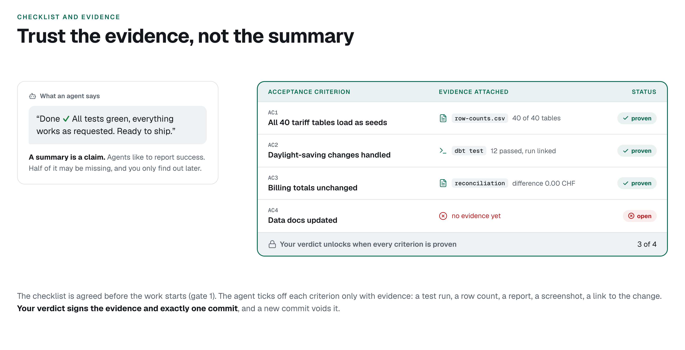
</picture>

## Mission Control

The desktop dashboard is where you work through what's waiting for you: questions first, then approvals and verdicts. Each prompt shows exactly what you are about to sign.

| | |
|---|---|
| 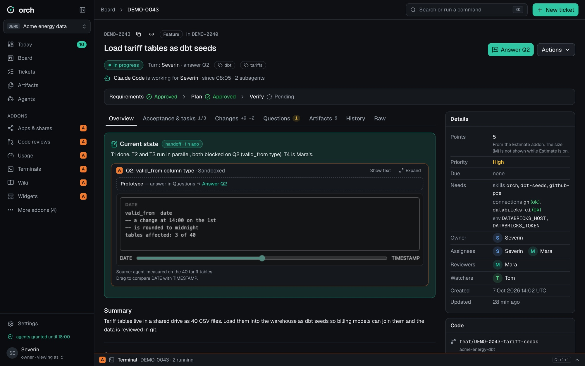 | 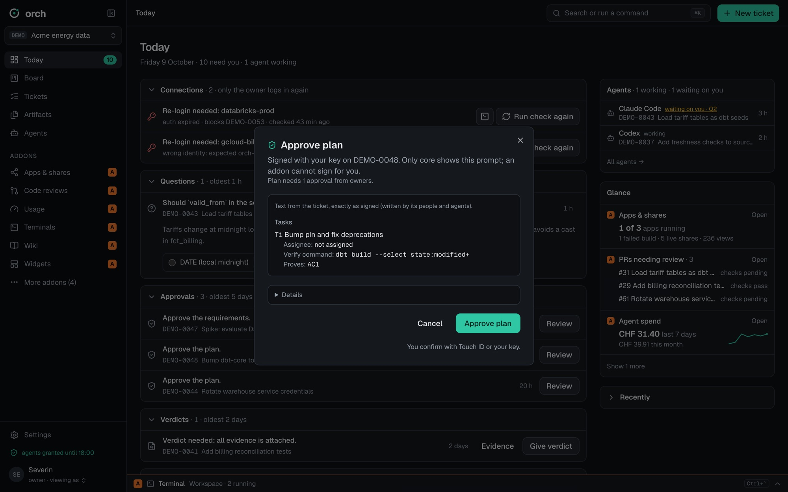 |
| **Ticket page.** Gates at a glance, the handoff note, questions, evidence and history. | **Approve.** The exact text you sign. Only core can show this prompt, not an addon. |
| 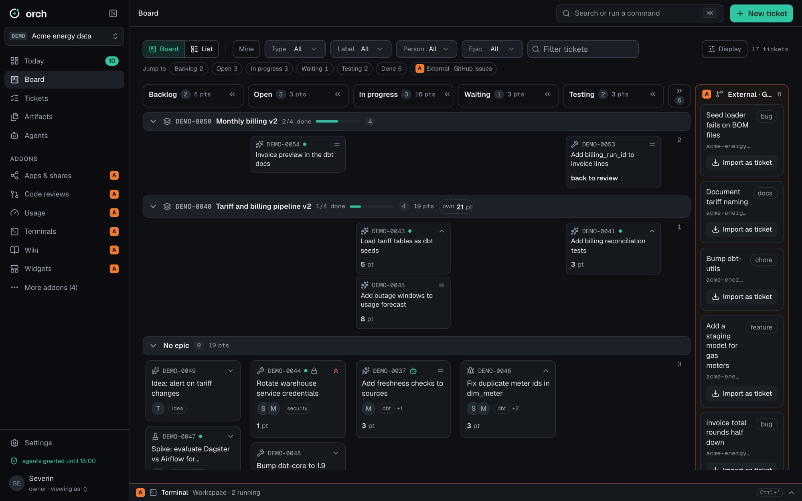 | 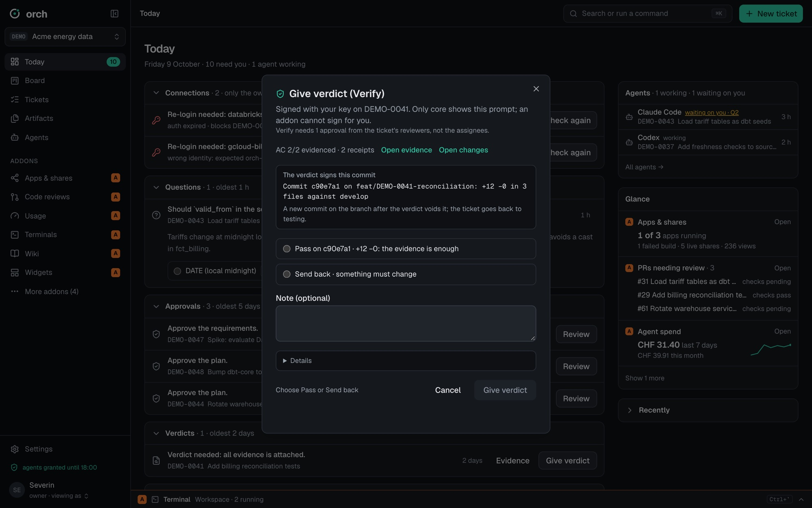 |
| **Board.** Epics as swimlanes, and addons add their own lanes. | **Verdict.** Signs one commit. A new commit voids it. |

<sub>The screens show example data.</sub>

## orch mobile

Answer questions and sign gates from your iPhone. One QR scan joins a workspace, logging out wipes it from the phone, and every signature needs Face ID. The key never leaves the phone's secure chip.

<table>
  <tr>
    <td><picture><source media="(prefers-color-scheme: dark)" srcset="docs/images/readme/mobile-home-dark.jpg">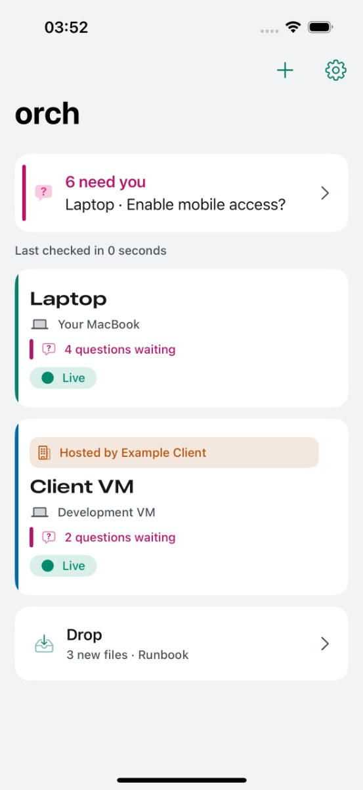</picture></td>
    <td><picture><source media="(prefers-color-scheme: dark)" srcset="docs/images/readme/mobile-tickets-dark.jpg">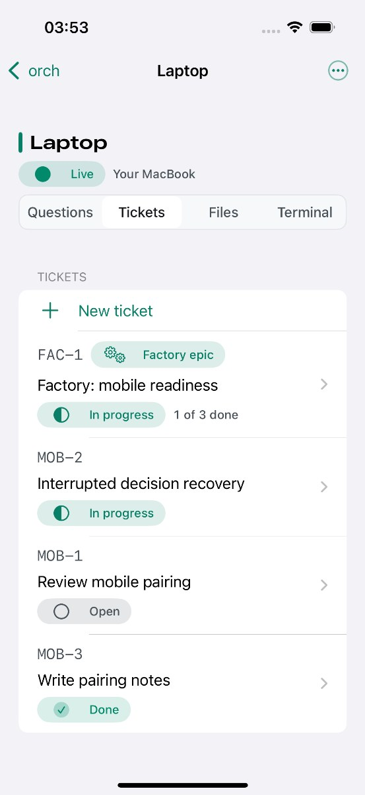</picture></td>
    <td><picture><source media="(prefers-color-scheme: dark)" srcset="docs/images/readme/mobile-question-dark.jpg">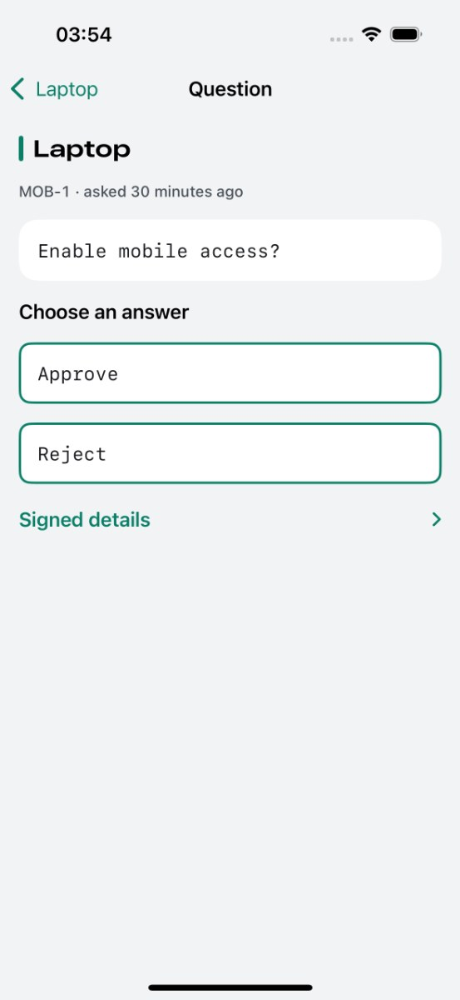</picture></td>
    <td><picture><source media="(prefers-color-scheme: dark)" srcset="docs/images/readme/mobile-sign-dark.jpg">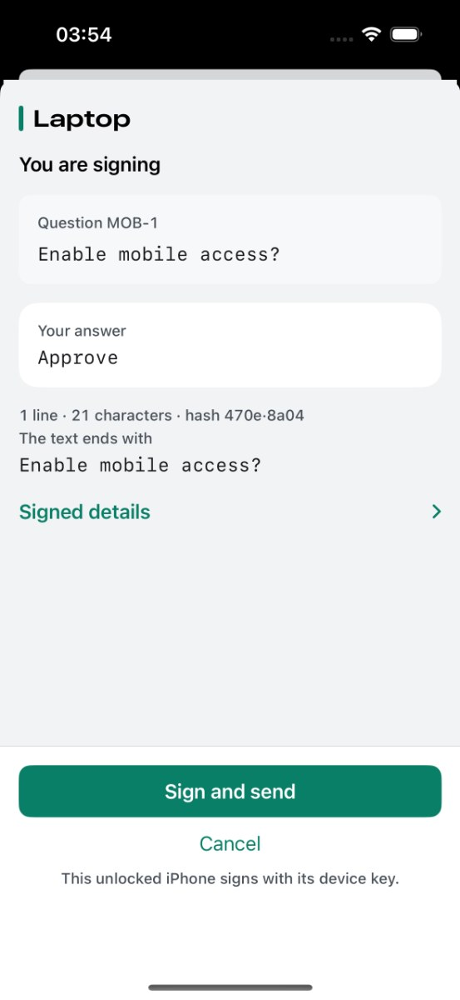</picture></td>
  </tr>
  <tr>
    <td align="center"><sub>Workspaces</sub></td>
    <td align="center"><sub>Tickets</sub></td>
    <td align="center"><sub>A question</sub></td>
    <td align="center"><sub>Sign and send</sub></td>
  </tr>
</table>

## AI Factory and Dark AI Factory

For bigger requests, sign a charter instead of every single gate. You set the limits once: how many tickets, how big each one may be, the budget, the target (a checked preview, or delivery), and a hold window before anything goes out. Inside those limits the agents split the request into tickets and build them; every approval the charter gives is marked "via the charter", and a code-review gate, if you turn one on, is never auto-approved.

<picture>
  <source media="(prefers-color-scheme: dark)" srcset="docs/images/readme/factory-dark.png">
  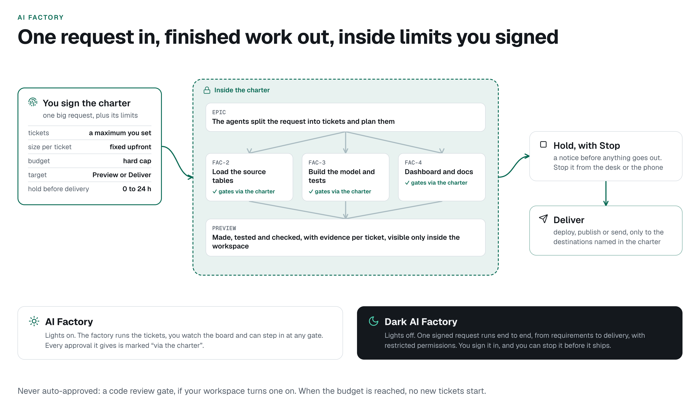
</picture>

- **AI Factory:** lights on. The factory runs the tickets while you watch the board, and you can step in at any gate.
- **Dark AI Factory:** lights off. One signed request runs end to end, from requirements to delivery, with restricted permissions. You sign it in, and you can stop it from your desk or your phone before it ships.

## Architecture

<picture>
  <source media="(prefers-color-scheme: dark)" srcset="docs/images/readme/architecture-dark.png">
  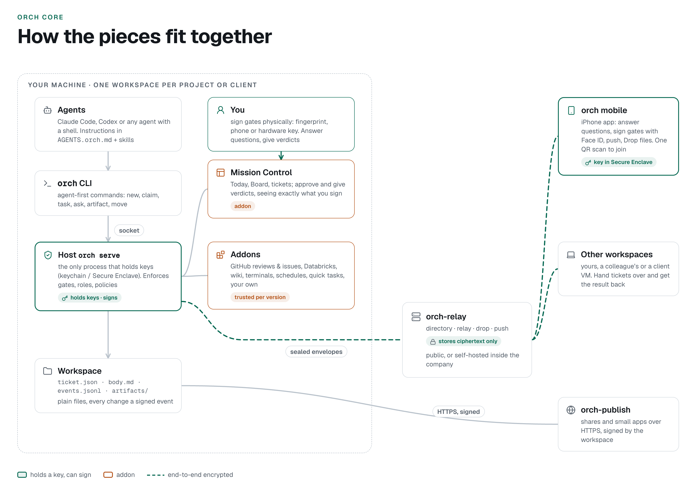
</picture>

| Piece | What it does | Where |
|---|---|---|
| **`orch` CLI** | Agent-first commands with terse output: `new`, `claim`, `task`, `ask`, `artifact`, `submit`. Any agent with a shell can use it. | [`plugins/orch-core`](plugins/orch-core) |
| **Workspace** | Plain files: `config.json`, `keys.jsonl` and, per ticket, `ticket.json`, `body.md`, `events.jsonl` and `artifacts/`. Every change is an appended, signed event. | your repo or folder |
| **Host** (`orch serve`, `orch host`) | The only process that loads keys (OS keychain or Secure Enclave). It enforces gates, roles and policies, and agents reach it through a narrow local socket. | [`plugins/orch-core`](plugins/orch-core) |
| **Mission Control** | The desktop dashboard. It's an addon itself. | [`addons/dashboard`](addons/dashboard) |
| **Addons** | GitHub reviews and issues, Databricks, wiki, terminals, schedules, quick tasks, or your own. Each one runs only after you trust that exact version. | [`addons/`](addons) |
| **orch-relay** | Directory, relay, Drop (files) and push. It stores and forwards ciphertext only, and runs as a public instance or self-hosted inside a company. | [orch-relay](https://github.com/severinlindenmann/orch-relay) |
| **orch mobile** | iPhone app: questions, approvals and verdicts signed with Face ID, push notifications and Drop. | [orch-mobile](https://github.com/severinlindenmann/orch-mobile) |
| **orch-publish** | Shares and small apps over HTTPS, in the workspace's own namespace and signed by the workspace. | [orch-publish](https://github.com/severinlindenmann/orch-publish) |

Workspaces can hand tickets to each other: yours, a colleague's or one on a client's VM. An incoming ticket lands in the inbox as untrusted data until you accept it.

## Works with your agent

orch doesn't depend on one harness. Every command is defined once, and gates and signatures are enforced by the CLI and the host, not by a hook in the agent.

| | Claude Code | Codex CLI and others |
|---|---|---|
| Install | plugin marketplace | `uv tool install`, then `orch init` writes `AGENTS.orch.md` |
| Instructions | `AGENTS.orch.md` and skills | `AGENTS.orch.md`, plus skills where the harness supports `SKILL.md` |
| Gates and signatures | enforced by orch | enforced by orch |
| Hand edits to ticket files | refused early by a guard hook | detected by `orch check` and `orch doctor`, or prevented by running agents under their own OS user |

Details: [harnesses and enforcement tiers](docs/architecture/orch-v2-harnesses.md).

## Get started

You need [uv](https://docs.astral.sh/uv/) and Python 3.14 or newer (uv installs it for you). You also need git 2.32 or newer: orch refuses to run an older git, because older versions silently ignore the setting orch uses to keep your own git configuration out of its git calls.

```bash
# Claude Code
claude plugin marketplace add severinlindenmann/orch-core
claude plugin install orch-core@orch-core

# Codex and any other agent with a shell
uv tool install "git+https://github.com/severinlindenmann/orch-core#subdirectory=plugins/orch-core"

# then, in your project
orch init           # creates the workspace and writes AGENTS.orch.md
orch host enable    # starts the host that holds the keys
orch help work      # what an agent reads first
```

On a Mac and not sure where to start? Follow [Set up a personal workspace](docs/setup-personal-workspace.md): every step with what you should see and what to do if you don't.

## Documentation

- [Design](docs/architecture/orch-v2.md): decisions, threat model, keys, relay, mobile
- [The minimal core](docs/architecture/orch-v2-core.md) and the [ticket format](docs/architecture/orch-v2-ticket-format.md)
- [Host process](docs/architecture/orch-v2-host.md): socket API, signing, custody and worker isolation
- [Harnesses and enforcement tiers](docs/architecture/orch-v2-harnesses.md)
- [Dashboard addon](addons/dashboard/README.md)

## Development

From `plugins/orch-core`:

```bash
uv sync
uv run pytest -q -m "not slow"
```

The diagrams are drawn from [`docs/images/readme/src/diagrams.html`](docs/images/readme/src/diagrams.html), and `node render.cjs` re-renders the PNGs. See [CONTRIBUTING.md](CONTRIBUTING.md) for the checks CI runs. Report vulnerabilities privately as described in [SECURITY.md](SECURITY.md), never in a public issue.

## License

orch is source-available under the [PolyForm Noncommercial License 1.0.0](LICENSE): free for noncommercial use. Commercial use needs a separate license from the author.
